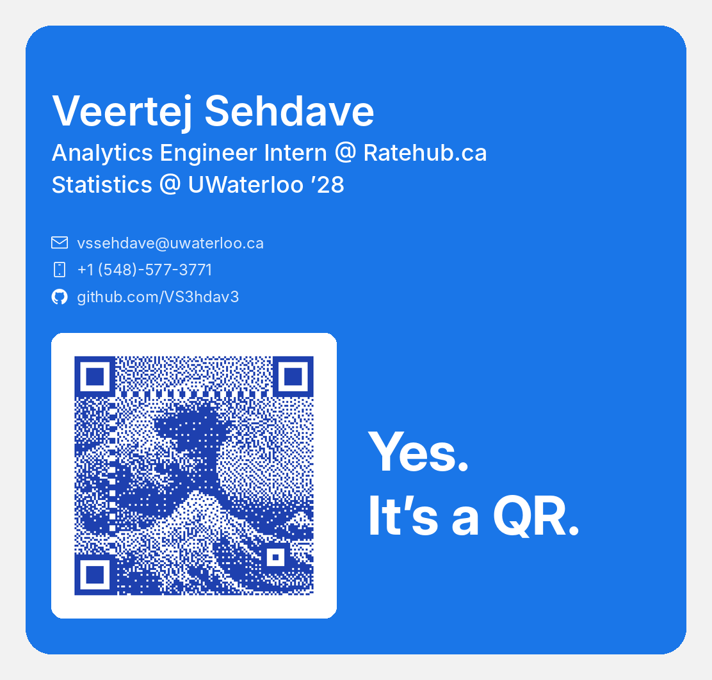

# wallet-pass

A digital business card for Google Wallet. It carries my roles, contact details
and an artistic QR code that opens my LinkedIn. Pull it up on my phone and
anyone can scan it.

<p align="center">
  
</p>

## How it works

Google Wallet's generic pass has a fixed layout: a title row, a large header
line, then a hero image. Wallet draws its own fields in its own fonts and sizes,
and it can only render plain black barcodes. So this project:

- puts my name in the **header** line, the largest text Wallet allows
- shows my photo in the **logo** circle at the top
- puts "Digital Business Card" in the small **card title** row
- bakes everything else into **`output/hero.png`**: the role lines, contact
  rows with icons, and the artistic QR with its tagline
- adds email, phone, GitHub and LinkedIn as tappable links on the **back of the pass**

The pass itself is a signed JWT inside an "Add to Google Wallet" link. No API
calls or server are needed. Google reads the pass definition from the token
when you tap Save.

## Project structure

```
assets/
  qr/qr.png            source QR (links to LinkedIn)
  icons/               mail, phone and GitHub icons (Octicons, MIT)
  fonts/               Inter (SIL OFL 1.1)
scripts/
  prep_image.py        crops and compresses a photo for the QR art generator
  make_assets.py       renders output/hero.png and output/preview.png
  verify_qr.py         checks the QR in the hero still scans
  create_pass.py       signs the pass and prints the save link
output/
  hero.png             served publicly from this repo for Wallet to fetch
  logo.jpg             photo for the logo circle, also served publicly
  preview.png          rough mock of the card front
```

## Setup

You need an Android phone. Google Wallet isn't available on iPhone.

1. **Issuer account.** Sign in at the
   [Google Pay & Wallet Console](https://pay.google.com/business/console),
   create a business profile and copy the issuer ID.
2. **Google Cloud project.** Create a project, enable the **Google Wallet API**,
   then create a service account and download a JSON key. No billing account or
   free trial is needed for this.
3. **Link them.** In the Wallet console under **Users**, invite the service
   account's email with the **Developer** role.
4. **Configure.** Copy `.env.example` to `.env`, fill in the issuer ID and the
   path to your key, and install dependencies:

   ```bash
   pip install -r requirements.txt
   ```

`.env` and all `.json` files are gitignored. The service account key must never
be committed, because anyone holding it can issue passes as you.

## Making the QR art

The QR is generated with [WOW QR](https://wowqr.app/#editor), which turns a
photo into a scannable QR. `prep_image.py` gets a photo ready for it: a square
crop at 1176x1176 (the size of the source QR), corrected phone rotation, and an
optimized PNG plus a high-quality JPEG.

```bash
python scripts/prep_image.py photo.jpg                   # centre crop
python scripts/prep_image.py photo.jpg --focus 0.5 0.0   # top middle
```

`--focus X Y` sets the crop centre as fractions of width and height, and
`--zoom` crops tighter (e.g. `0.4` for a face close-up):

```bash
python scripts/prep_image.py photo.jpg --focus 0.47 0.28 --zoom 0.43 --size 660
```

For the logo, Google asks for a square image of at least 660x660, unmasked;
Wallet does the circle crop itself. `output/logo.jpg` is a square photo used
whole, set through `LOGO_URL`. Images
smaller than 1176 px are never upscaled. Results go to `output/prepped/`, which
is gitignored. Save the generated QR from WOW QR as `assets/qr/qr.png`.

## Usage

```bash
python scripts/make_assets.py              # render hero.png and preview.png
python scripts/verify_qr.py                # make sure the QR still scans
python scripts/create_pass.py --out link.txt
```

Push `output/hero.png` first, because Wallet fetches it from `HERO_URL` at save
time. Then open the printed link on your phone and tap **Save**.

Options for `create_pass.py`:

| Flag        | What it does                                                    |
|-------------|-----------------------------------------------------------------|
| `--out FILE`| also writes the link to a file (`link.txt` is gitignored)       |
| `--barcode` | adds Google's standard QR as a more scan-friendly fallback      |

## Making changes

- Edit text, contacts or spacing at the top of `scripts/make_assets.py`, then
  re-render and re-run `verify_qr.py`.
- Wallet caches passes by ID. After any change, bump `OBJECT_SUFFIX` in
  `scripts/create_pass.py` and generate a new link, then delete the old pass
  from your wallet.

## Notes

- New issuer accounts start in demo mode. Only the issuer and added test
  accounts can save the pass, which is fine for a personal card.
- The artistic QR is fragile at small sizes. `verify_qr.py` tests it shrunk and
  blurred to approximate a phone camera, but the real test is scanning it off
  your screen.
- Wallet requires a visible card title. Blank or whitespace-only values are
  rejected with "Default value for LocalizedString cannot be empty".

## Credits

- Icons from [Octicons](https://github.com/primer/octicons), MIT License. See
  `assets/icons/LICENSE-octicons`.
- [Inter](https://github.com/rsms/inter) typeface, SIL Open Font License 1.1.
  See `assets/fonts/OFL.txt`.
